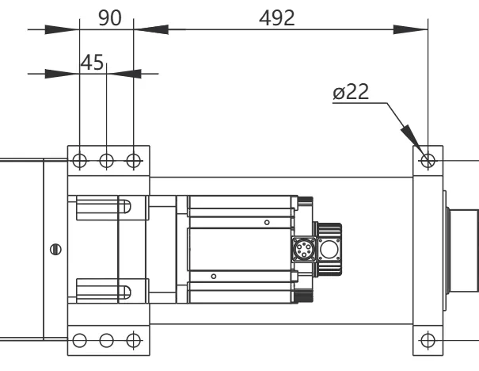
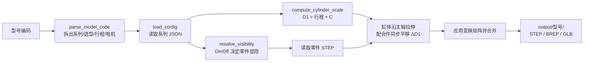
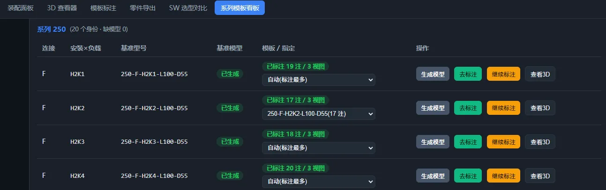
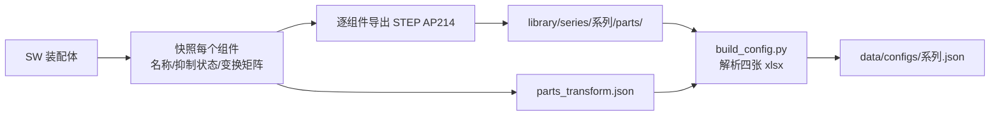
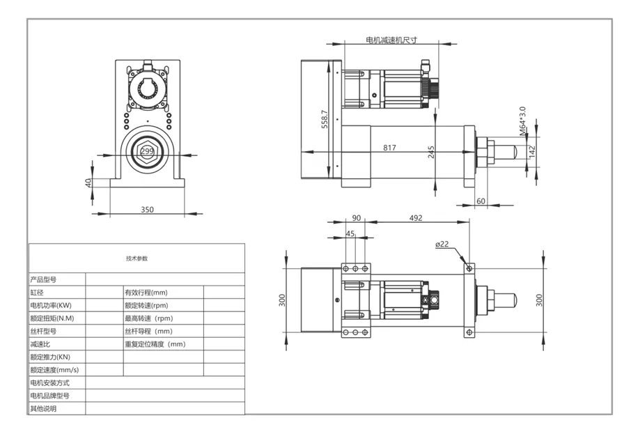
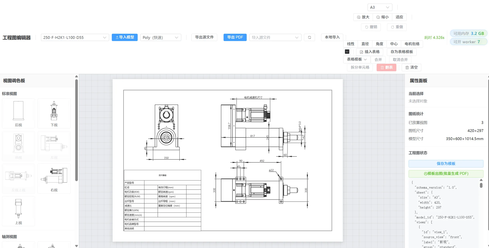
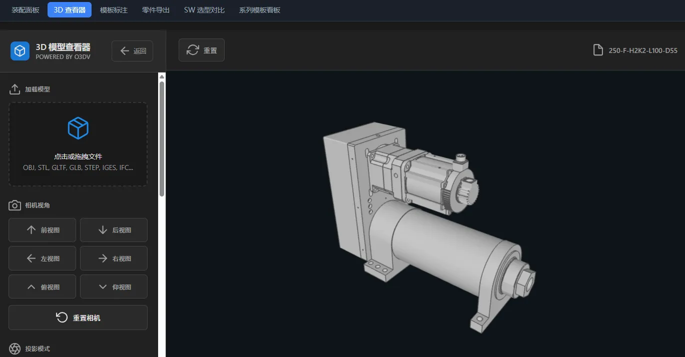

# STEP / GLB 工程图服务

  

从型号编码到可交付工程图：装配体重建 → HLR 投影 → 标注重绑 → PDF / DXF / GLB 导出。

面向液压缸系列产品的参数化装配体生成与工程图出图服务。输入型号与选型参数，服务按系列零件库重建装配体，产出 STEP / GLB 模型以及 PDF、SVG、DXF 工程图；浏览器端提供 3D 查看、标注编辑和系列模板覆盖度看板。

几何链基于 pythonOCC：HLR 把 B-Rep 投影成 2D 线段与圆/弧，再结合语义锚点、同系列模板复用和标注重绑生成图纸。标注与型号解耦，一份模板可以覆盖同系列不同行程、不同安装方式的型号；精确圆的圆心与半径取自 B-Rep 圆边，可见性与边线几何交给离散投影，兼顾精度和速度。



孔距、孔径等标注由实例模板重绑到当前型号，失配会显式报告而不是静默错位。

## 能做什么

- 型号编码驱动装配体重建：安装方式、负载连接、电机、行程由系列装配表控制，缸体按 `D1 = 行程 + C` 拉伸
- 精确与离散两套 HLR 投影链路；圆的圆心/半径直接取 B-Rep 真值，避免从三角网格反推的偏差
- 一份实例模板覆盖同系列多个型号：改行程或换电机后按几何指纹重绑标注，视图轴向由投影方向自动推导，失配显式报告而不是静默错位
- 浏览器端 Vue 3 标注编辑器、3D 查看器、系列模板覆盖度看板；后端 Flask + OCC 任务池支持并发出图
- 输出 STEP / GLB / PDF / SVG / DXF，带 251 个 pytest 回归用例

## 装配是怎么被型号驱动的

以 `250-E-H2K1-L100-D55` 为例，型号编码就是一次选型的全部输入：

| 段 | 示例 | 含义 | 数据来源 |
| --- | --- | --- | --- |
| 系列 | `250` | 决定用哪个零件库与系列配置 | `library/series/250直连/`、`data/configs/250直连.json` |
| 连接类型 | `E` | 直连；`F` 为折返 | 决定系列目录名（`250直连` / `250折返`） |
| 安装方式 + 负载连接 | `H2K1` | `H2` 底部安装，`K1` 螺纹头 | `安装方式.xlsx`、`负载连接方式.xlsx` |
| 行程 | `L100` | 有效行程，写 `100` 也接受 | `缸体长度.xlsx` |
| 电机 | `D55` | 可省略；`D55` = 5.5KW 电机 | `电机.xlsx` / `电机减速机.xlsx` |

`YRJ250-...` 与 `250-...` 视为同一型号：解析时去掉品牌前缀，查找产物时原写法、去前缀、加前缀三种都会试。

**选型表变成配置。** 每个系列的四张 xlsx 由 `src/core/build_config.py` 解析成 `data/configs/<系列>.json`：

```text
图库项目/<系列>/
  安装方式.xlsx        代号 + OnFeature / OffFeature
  负载连接方式.xlsx    代号 + OnFeature / OffFeature
  电机.xlsx            编号 + 减速机 + On/Off（或 电机减速机.xlsx，可带扭矩列）
  缸体长度.xlsx        L100 → D1 的逐行对照表
        │  build_config.py
        ▼
data/configs/<系列>.json   mount / load / motor / cylinder / base_parts
```

列名按表头 `OnFeature` / `OffFeature` 识别，老表没有表头时才按固定列序回退；所以各系列表的列顺序不同也能解析。

OnFeature / OffFeature 写的零件名形如 `250前盖<1>`，尖括号里的数量只用于按基础名匹配，不会复制出多份实例。运行时先把 `base_parts` 设为显示，再按「安装方式 → 负载连接 → 电机」的顺序逐张表处理：表内先 OffFeature 抑制、后 OnFeature 显示（同一张表里 On 优先），后处理的表可以改回前面表的显隐。三张表都没提到的零件默认显示。电机段还带出功率、扭矩和刹车标记，供选型面板展示。

缸体长度表先存成 `L100 → 440` 这样的逐行对照，若所有行都符合同一个常数，则再记下公式 `D1 = 行程 + C`。**C 是系列自己的基础值**：250 是 340，190 是 330，380 是 569，装配面板和后端重建用的是同一份配置，不会各算各的。

**一次 build 的过程：**



零件 STEP 的位置与装配位姿都来自零件库：实例的旋转/平移矩阵由 SolidWorks 导出时记录，重建时把列主序旋转转置、平移从米换成毫米，再逐个应用到形状上。缸体沿包围盒最长轴非均匀拉伸后，主轴方向上位于缸体前侧的零件平移同样的 ΔD1，避免端盖、推杆脱离缸体。

`/api/build` 把一次构建交给进程池异步执行（同型号去重），产物落在 `output/<型号>/`：

```text
assembly.step      XCAF 导出，保留零件名与装配层级
assembly.brep      内部缓存，出图/锚点解析免于反复解析大 STEP
assembly.glb       3D 查看器与小程序用
cylinder.step      缸体拉伸验证件
build_info.json    显隐、D1、缩放比例与各步耗时
```

后续出图用 `find_model_shape()` 按型号找 `assembly.step`（找不到就用 `assembly.brep`），所以**必须先 build 再出图**。模板复用、标注重绑与失配处理见 `docs/同系列模板复用规则.md`，出图流程见 `docs/目录结构与模板出图流程.md`，接口参数见 `docs/关键接口说明.md`。

系列看板按「系列 × 连接 × 安装负载」枚举模板身份，标出基准模型与标注是否齐备，人工标注就从这里进入：



## 零件库从哪来：SolidWorks 零件导出

装配阶段不调用 SolidWorks——它只在准备零件库时用一次。在 Windows 上打开 `/part-export`，选系列和该系列下的 SW 装配体，可以先「预览组件」看清有哪些零件、哪些被抑制，再点「导出」，最后「生成配置」。




导出成功后，零件库与配置一起落盘：

```text
library/
  series/<系列>/
    parts/                 零件 STEP（AP214）
    parts_transform.json   实例名 → STEP 文件 + 原始路径 + 16 位变换矩阵 + 抑制状态
    meta.json              源装配体、导出时间、组件数
  shared/                  电机/减速机等跨系列共享件
```

几个容易误解的地方：

- 它是「按系列把整个装配体导完」，不是逐个零件勾选；格式固定 STEP AP214，导出请求体里的 `overwrite` 决定是否覆盖已有 STEP（默认跳过，便于断点续导）。
- 变换矩阵取自 SW 组件的 `Transform2`：旋转是列主序、平移单位是米，重建装配时要转置旋转并把平移 ×1000 换成毫米。
- 多个组件可以共用同一个零件 STEP，实例名（如 `250前盖-1`）作为 `parts_transform.json` 的 key，配置表匹配时用基础名。
- Linux 上导出接口返回 501，服务靠 Windows 上预导出的 `library/` 运行；这也是部署文档要求先准备零件库的原因。零件库、xlsx 与生成产物都不入库，避免把客户资料传上仓库。

为什么这么设计、以及不用 SolidWorks 也能出图的替代路径，见 `docs/SW功能自研替代方案.md`。

### 图库项目目录要放什么

`图库项目/` 是只读的 SolidWorks 原始图库，不入库，需按系列自行准备。**子目录名就是系列名**：型号 `250-E-...` 对应 `图库项目/250直连/`，`250-F-...` 对应 `图库项目/250折返/`，名字对不上时配置生成和零件导出都找不到目录。以 `图库项目/250直连/` 为例：

| 文件 | 用途 | 必要性 |
| --- | --- | --- |
| `安装方式.xlsx`、`负载连接方式.xlsx` | 选型代号与 OnFeature / OffFeature，决定零件显隐 | 必需 |
| `电机.xlsx`（或 `电机减速机.xlsx`） | 电机编号、减速机、功率/扭矩/刹车；选型面板的电机下拉同源 | 必需 |
| `缸体长度.xlsx` | L100 → D1 的逐行对照，给出该系列的 C 值 | 必需 |
| `<系列>装配体.SLDASM` | 零件导出的输入 | Windows 导出必需 |
| 装配体引用的 `*.SLDPRT` | 被导出的零件实体，通常和 SLDASM 同目录 | Windows 导出必需 |
| `~$*`（SW 锁文件） | SolidWorks 打开文件时生成的临时文件 | 不用管，扫描时自动跳过 |
| `*.SLDDRW`、`*.pdf`、`*.zip`、`*.STEP`、`parts_step/`、`parts_transform.json` | 人工出图产物或旧版导出残留 | 新链路不读，可留可删 |

一个实际的坑：导出时默认要求系列目录里**恰好一个** `.SLDASM`。`250直连` 下并存 `250直连装配体.SLDASM`、`250直连装配体_parallel.SLDASM`、`...ce1`、`...ce2` 时，必须在 `/part-export` 页面显式选一个，或 CLI 传 `--assembly 文件名`；否则会报「多个候选」。`~$` 开头的临时文件不参与计数。

图库目录之外，这些文件也要放到位：

| 文件 | 作用 | 缺失时 |
| --- | --- | --- |
| `data/screw_table.xlsx` | 系列 → 丝杆型号/导程/缸径（单文件多 sheet，按「名称」列分组） | 选型页导程下拉为空 |
| `data/templates/engineering/*.json` | 人工标注的基准型号模板（L100 + 首个电机） | 能出裸图但没有尺寸标注 |
| `data/configs/<系列>.json` | 由 `build_config.py` 生成，不是手工放 | 后端无法解析型号里的选型段 |
| `.env` | 出图算法、离散精度等配置 | 走默认值，可能与生产不一致 |

准备顺序：

1. 四张 xlsx 加上 SLDASM / SLDPRT 放进 `图库项目/<系列>/`
2. 在 Windows 的 `/part-export` 导出零件，产物写入 `library/series/<系列>/`（`parts/`、`parts_transform.json`、`meta.json`）。图库目录里旧的 `parts_step/` 和 `parts_transform.json` 不再被读取
3. 生成系列配置：`python src/core/build_config.py <系列名>` → `data/configs/<系列名>.json`
4. 放好 `data/screw_table.xlsx` 与标注模板，就可以 build 和出图

第 2 步依赖 Windows 上的 SolidWorks COM；第 3 步及之后的 build / 出图都能在 Linux 上跑。

## 5 分钟跑出第一张图

仓库内置一个真实的 250 系列 E 型装配体（`examples/data/250-E-H2K1-L100-D55.brep`，约 3 MB 的 BREP 拓扑数据，不含客户信息）。`examples/quickstart.py` 直接对它做 HLR 投影，不需要系列零件库或模板：

```bash
conda create -n pdf1 python=3.10
conda activate pdf1
conda install -c conda-forge pythonocc-core
pip install -r requirements.txt
python examples/quickstart.py
```

产物在 `examples/output/`：`front.svg` / `left.svg` / `left_top.svg` 三个视图。换成自己的模型用 `python examples/quickstart.py --step 路径/模型.step`。完整 Web 服务的运行方式见下面的「环境准备」与「启动后端」，系列零件库与模板数据需自行准备（见「运行数据不入库」）。

完整服务在此基础上套用实例模板并导出 PDF：



## 环境准备

后端使用 Python 3.10，conda 环境名 `pdf1`。`pythonocc-core` 只提供 OCC 的 import，没有 pip 元数据，必须走 conda-forge 安装，不能用 venv 代替：

```bash
conda create -n pdf1 python=3.10
conda activate pdf1
conda install -c conda-forge pythonocc-core
pip install -r requirements.txt
```

`requirements.txt` 里是 Flask 3、reportlab、ezdxf、PyMuPDF、trimesh、numpy、openpyxl、svglib、pytest、boto3；其中 boto3 只在启用对象存储后端时才需要，代码里延迟导入。Linux 上还需要系统的 OpenGL / X11 共享库，参见 `docs/Linux 部署适配清单.md`。

## 启动后端

```bash
conda activate pdf1
python src/web/server.py
```

服务默认监听 `0.0.0.0:5001`，端口固定，绑定地址由 `STEP_HOST` 控制（设 `127.0.0.1` 则只在本机开放）。入口 `src/web/server.py` 转到 `src/web/app.py` 的 `main()`，`create_app()` 负责加载 `.env`、初始化 OCC 任务池并注册 11 个蓝图。生产部署用 WSGI 入口 `web.app:app` 搭配 gunicorn 与 Nginx，步骤见 `docs/DEPLOY_BAOTA.md`。

启动后的主要页面：

| 路径 | 用途 |
| --- | --- |
| `/` | 装配选型与构建面板 |
| `/viewer` | 装配体 3D 查看器 |
| `/drawing`、`/editor` | 工程图页面与 Vue 标注编辑器 |
| `/series` | 系列模板覆盖度看板 |
| `/part-export` | 零件导出 |
| `/sw-compare` | SolidWorks 选型对比（依赖 Windows COM） |

API 按蓝图分组：装配构建 `/api/build`、`/api/task/<id>`、`/api/options`；工程图 `/api/drawing-views/<型号>`、`/api/drawing-pdf`、`/api/drawing-dxf/<型号>`；模板出图 `/api/template-drawing/*`；另有视图调色板、符号库、表格预设、图纸源、服务端渲染与系列看板等接口。完整清单见 `docs/关键接口说明.md`。

## 前端编辑器

`cad-viewer-app/` 是独立的 Vue 3 + Vite + TypeScript 应用，基于 `@mlightcad/cad-viewer` 实现工程图标注编辑，样式配置与后端共用根目录的 `cad_viewer_style.json`。开发服务器跑在 5174，并把 `/api`、`/static` 代理到后端 5001；构建产物在 `cad-viewer-app/dist`，由 `/editor` 直接托管，dist 缺失时该路径返回 503。

```bash
cd cad-viewer-app
npm install
npm run dev          # 开发调试
npm run build        # 构建到 dist，/editor 依赖此步骤
npm run type-check
```

标注编辑器：左侧视图调色板、中间图纸与尺寸线、右侧属性面板。



3D 查看器独立于编辑器，支持加载模型、切换标准视角与显隐零件。



## 配置

复制 `.env.example` 为 `.env`（`.env` 不入库）。项目自己解析根目录的 `.env`，不依赖 python-dotenv，且已存在的环境变量优先。

| 键 | 说明 |
| --- | --- |
| `STORAGE_BACKEND` | `local`（默认）或 `oss`，决定结果写本地还是镜像到对象存储 |
| `OSS_ENDPOINT` / `OSS_REGION` / `OSS_BUCKET` | S3 兼容对象存储的接入信息 |
| `OSS_ACCESS_KEY_ID` / `OSS_ACCESS_KEY_SECRET` | 对象存储密钥，只放在本地 `.env` |
| `OSS_PREFIX` / `OSS_PUBLIC_BASE` / `OSS_PRESIGN_EXPIRE` | key 前缀、公开基址、签名 URL 有效期 |
| `BUILD_POOL_WORKERS` | OCC 任务池 worker 数，默认 `min(4, CPU 核数)` |
| `STEP_HOST` | Flask 绑定地址 |
| `OCC_POOL_INLINE` / `BUILD_POOL_MAX_TASKS_PER_CHILD` | 任务池调试与 worker 回收参数 |
| `DRAWING_ALGO` | 切换 HLR 精确算法与离散投影算法 |
| `DRAWING_POLY_DEFLECTION` / `DRAWING_POLY_DO_FIT` | 离散投影的精度与拟合开关 |

保持 `STORAGE_BACKEND=local` 就是纯本地运行，所有结果落在 `output/`。单个跑过投影的 worker 常驻 290–480 MB，`BUILD_POOL_WORKERS` 按可用内存调整。

## 目录

```
src/core/     装配体重建、HLR 投影、路径与存储
src/drawing/  图纸模板、标注重绑、PDF / SVG / DXF 渲染
src/batch/    批量出图 CLI
src/web/      Flask 应用、蓝图、任务池、静态资源
cad-viewer-app/  Vue 标注编辑器
tests/        pytest 用例
docs/         设计与部署文档
tools/        开发期一次性探针和调试脚本
tools/ 下的脚本不属于正式产线，也不由 pytest 管理，用途见 `docs/tools 临时脚本说明.md`。
```

代码分层依赖为 `web → batch → drawing → core`，路径常量集中在 `src/core/paths.py` 与 `src/web/common.py`。

## 测试

```bash
conda run -n pdf1 python -m pytest tests/ -v
```

24 个测试文件覆盖 API、路径、配置、模板出图、标注与 HLR 拟合；依赖 OCC 或真实模型的用例用 `importorskip`、`monkeypatch`、`tmp_path` 打桩或跳过。

## 运行数据不入库

系列零件库、模板与结果文件不纳入版本控制：`图库项目/`、`library/`、`parts_step/`、`reference/`、`output/`、`logs/`、`data/`、`verify/`，以及 `*.step`、`*.glb`、`*.SLD*`、`*.xlsx` 等大二进制。按这份清单配置本地忽略规则，避免把客户资料和生成产物误提交。克隆后需要自行准备系列零件库与模板数据；服务会在 `data/configs`、`data/templates`、`data/symbols` 等路径读写，约定见 `docs/目录结构与模板出图流程.md` 和 `docs/关键接口说明.md`。

## 文档索引

`docs/目录结构与模板出图流程.md` 记录分层与模板流程，`docs/关键接口说明.md` 说明接口与并发模型，`docs/同系列模板复用规则.md` 定义模板复用的身份判定，`docs/标注样式配置说明.md` 说明前后端共用样式字段。部署相关有 `docs/DEPLOY_BAOTA.md` 与 `docs/Linux 部署适配清单.md`，几何与编辑器设计另有若干方案文档。
